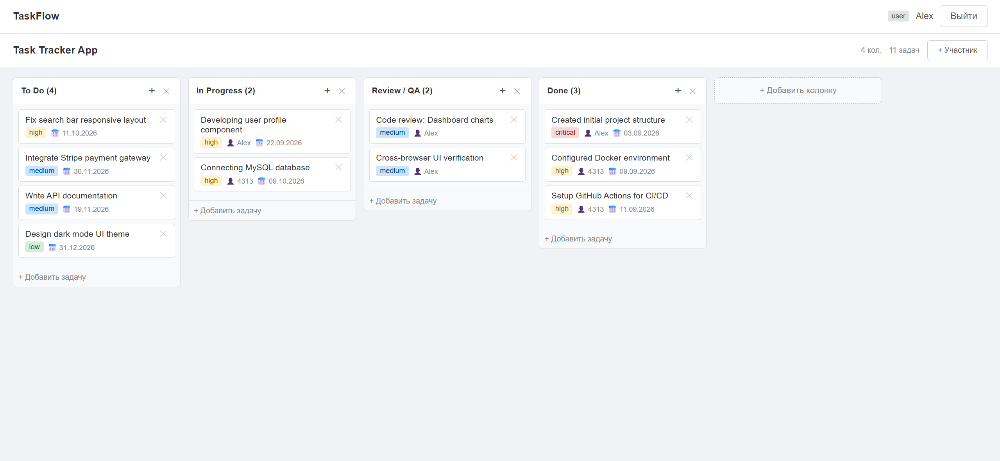
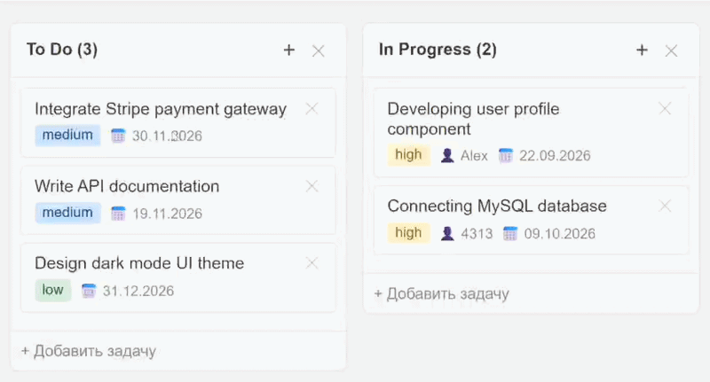

[English](README.md) | **Русский**

# Task Tracker

[](https://github.com/Iskhakov-06/kanban-task-tracker/actions/workflows/ci.yml)

Канбан-доска в стиле Trello: создавайте доски, раскладывайте работу по колонкам, перетаскивайте задачи между ними и работайте вместе с командой. Полноценное full-stack приложение с REST API, JWT-аутентификацией и ролевой моделью доступа.

<p align="center">
  
</p>

<p align="center">
  
</p>


## Возможности

- **Канбан-доски** с колонками и задачами, drag-and-drop (dnd-kit)
- **Аутентификация**: регистрация с подтверждением email, вход, сброс пароля, JWT access + refresh токены (refresh-токен хранится в HTTP-only cookie)
- **Ролевая модель доступа**: глобальные роли (`user` / `moderator` / `admin`) и роли участников внутри каждой доски
- **Командная работа**: добавление и удаление участников доски
- **Комментарии к задачам** и **история изменений** для каждой задачи
- **Валидация** всех входящих данных (express-validator), централизованная обработка ошибок
- **Структурированное логирование** (winston) и логирование запросов
- **Версионируемые миграции БД** (umzug), автоматически применяются при старте
- **Автотесты** (Jest + Supertest, 120+ тестов на реальной MySQL) и CI-пайплайн на **GitHub Actions**
- **Docker Compose** для MySQL + API

## Стек технологий

| Слой | Технологии |
|---|---|
| Frontend | React 18, Vite, Redux Toolkit, React Router, Axios, dnd-kit |
| Backend | Node.js 22, Express, Sequelize, umzug (миграции), JWT, bcrypt, Nodemailer, winston |
| База данных | MySQL 8 |
| DevOps | Docker, Docker Compose |

## Быстрый старт

### Требования

- Docker с Compose v2 (рекомендуется) либо Node.js 22+ и локальная MySQL 8

### 1. Клонирование

```bash
git clone https://github.com/Iskhakov-06/kanban-task-tracker.git
cd kanban-task-tracker
```

### 2. Настройка

```bash
cp .env.example .env
```

Заполните `DB_ROOT_PASSWORD`, `DB_PASSWORD` и оба JWT-секрета
(сгенерировать можно командой `node -e "console.log(require('crypto').randomBytes(48).toString('hex'))"`).
SMTP-настройки нужны для подтверждения email и сброса пароля
(для локальной разработки удобно использовать сервис вроде Mailtrap).

### 3. Запуск всего через Docker

```bash
docker compose up --build
```

| Сервис | URL |
|---|---|
| Приложение (nginx + сборка React, проксирует `/api`) | http://localhost:3000 |
| API | http://localhost:5000 (health check: `GET /health`) |
| MySQL | `127.0.0.1:3306` |

При старте API применяет ожидающие миграции, поэтому схема БД создаётся автоматически (при любом значении `NODE_ENV`).

<details>
<summary>Запуск без Docker (с hot reload)</summary>

Требуются Node.js 22+ и локальная MySQL 8.

```bash
# backend
cd backend
cp .env.example .env      # заполните настройки БД и SMTP
npm install
npm run dev

# frontend (во втором терминале)
cd frontend
npm install
npm run dev               # http://localhost:3000, Vite проксирует /api на :5000
```
</details>

## Docker-конфигурация

- **Многоэтапные сборки**: образ backend содержит только production-зависимости; frontend собирается Vite и отдаётся через nginx, поэтому Node.js в финальном образе нет
- **Кэширование слоёв**: слои с зависимостями пересобираются только при изменении `package*.json`, кэш npm переиспользуется между сборками (BuildKit)
- **Безопасность**: контейнеры работают от непривилегированных пользователей, все Linux capabilities сброшены, включён `no-new-privileges`, секреты никогда не попадают в образы (`.dockerignore`)
- **Надёжность**: healthcheck у каждого сервиса, `depends_on` ждёт готовности зависимостей, `tini` как PID 1 для корректного завершения
- **nginx**: gzip, immutable-кэширование хэшированных ассетов, SPA fallback, reverse proxy для `/api`

## Миграции базы данных

Схема управляется версионируемыми миграциями в `backend/src/migrations`. Ожидающие миграции применяются автоматически при запуске API (чтобы отключить, задайте `AUTO_MIGRATE=false`). Применённые миграции отслеживаются в таблице `SequelizeMeta`.

```bash
cd backend
npm run migrate          # применить ожидающие миграции
npm run migrate:down     # откатить последнюю миграцию
npm run migrate:status   # показать применённые / ожидающие
```

Чтобы изменить схему, добавьте новый файл, например `src/migrations/20261001000000-add-labels.js`, экспортирующий `up({ context: queryInterface })` и `down(...)`. Файлы выполняются в порядке имён; никогда не редактируйте уже применённую миграцию.

## Тестирование

Интеграционные тесты (Jest + Supertest) запускают настоящее Express-приложение на реальной базе MySQL. Они покрывают аутентификацию (регистрация, подтверждение email, вход, ротация refresh-токенов, выход, сброс пароля), ролевую модель доступа (глобальные роли и роли на досках), изоляцию между досками, а также логику досок / колонок / задач / комментариев.

```bash
cd backend
cp .env.test.example .env.test   # доступы к БД; имя базы должно заканчиваться на "_test"
docker compose up -d db          # из корня репозитория, либо любая локальная MySQL 8
npm test                         # или: npm run test:coverage
```

Тестовая база создаётся и мигрируется автоматически. Тест-раннер отказывается запускаться, если имя базы не заканчивается на `_test`, потому что тесты очищают все таблицы. Исходящая почта замокана.

CI (`.github/workflows/ci.yml`) запускается при каждом push и pull request: backend-тесты на сервисном контейнере MySQL, сборка frontend и сборка обоих Docker-образов.

## Обзор API

| Раздел | Эндпоинты |
|---|---|
| Auth | `POST /api/auth/register`, `GET /api/auth/verify-email`, `POST /api/auth/login`, `POST /api/auth/refresh`, `POST /api/auth/logout`, `POST /api/auth/forgot-password`, `POST /api/auth/reset-password`, `GET /api/auth/me` |
| Доски | `GET/POST /api/boards`, `GET/PUT/DELETE /api/boards/:id`, `POST /api/boards/:id/members`, `DELETE /api/boards/:id/members/:userId` |
| Колонки | `GET/POST /api/boards/:boardId/columns`, `PUT/DELETE .../:columnId`, `PATCH .../:columnId/move` |
| Задачи | `GET/POST .../columns/:columnId/tasks`, `GET/PUT/DELETE .../:taskId`, `PATCH .../:taskId/move` |
| Комментарии и история | `POST .../:taskId/comments`, `DELETE .../:taskId/comments/:commentId`, `GET .../:taskId/history` |
| Пользователи | `GET /api/users`, `GET /api/users/:id` |

## Структура проекта

```
.
├── backend
│   ├── src
│   │   ├── app.js        # Express-приложение (экспортируется, используется в тестах)
│   │   ├── server.js     # точка входа: подключение к БД, миграции, запуск
│   │   ├── config        # база данных, логгер, почта
│   │   ├── controllers   # обработчики запросов
│   │   ├── middleware    # auth, RBAC, валидация, обработка ошибок
│   │   ├── migrations    # версионируемые миграции схемы (umzug)
│   │   ├── models        # модели Sequelize
│   │   ├── routes
│   │   ├── services      # бизнес-логика
│   │   ├── utils
│   │   └── validators
│   ├── tests             # интеграционные тесты Jest + Supertest
│   └── Dockerfile
├── frontend
│   ├── Dockerfile
│   ├── nginx.conf
│   └── src
│       ├── api           # axios-инстанс и вызовы API
│       ├── components
│       ├── pages
│       ├── router
│       └── store         # слайсы Redux Toolkit
├── .github/workflows     # CI-пайплайн
├── docker-compose.yml
└── .env.example
```

## Планы

- [ ] Обновления в реальном времени (WebSockets)
- [ ] Тесты для frontend
- [ ] Вложения к задачам и метки

## Лицензия

MIT
